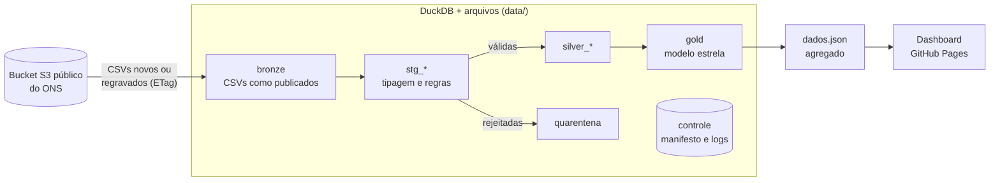

# energia-sin-pipeline

Pipeline diário com os dados abertos do ONS (Operador Nacional do Sistema Elétrico):
carga, geração por usina, intercâmbio entre regiões e capacidade instalada do Sistema
Interligado Nacional. Os dados passam por camadas bronze, silver e gold, com testes de
qualidade e quarentena, e terminam num modelo estrela e num dashboard público.

**Dashboard:** https://glucas290.github.io/energia-sin-pipeline/

Tudo roda com ferramentas gratuitas e sem servidor: Python, DuckDB, dbt e GitHub Actions.

## Arquitetura



| Etapa | Ferramenta | Onde |
| --- | --- | --- |
| Ingestão incremental | Python (requests) | [`ingestao/`](ingestao) |
| Armazenamento e processamento | DuckDB | `data/energia.duckdb` |
| Transformação, testes e quarentena | dbt (dbt-duckdb) | [`dbt/`](dbt) |
| Dashboard | HTML + ECharts, gerado em Python | [`dashboard/`](dashboard) |
| Orquestração e publicação | GitHub Actions + GitHub Pages | [`.github/workflows/`](.github/workflows) |

## O que o pipeline faz

- **Ingestão incremental e idempotente.** Lista o bucket do ONS, compara o ETag de cada
  arquivo com um manifesto e baixa só o que é novo ou foi regravado (o ONS revisa meses
  já publicados). O download é atômico: arquivo incompleto nunca entra na bronze.
- **Schema declarado e quarentena.** A silver lê tudo como texto e aplica os tipos com
  `try_cast`. Linha que viola uma regra vai para `silver.quarentena` com o motivo e os
  valores brutos, em vez de quebrar o pipeline ou sumir.
- **Incremental no dbt.** A geração horária (17,5 milhões de linhas) reprocessa só os
  arquivos baixados desde o último build: 14 s na carga completa, 1 s com um mês regravado.
- **Modelo estrela.** Quatro fatos (`fato_carga`, `fato_geracao`, `fato_intercambio`,
  `fato_capacidade`) e quatro dimensões (`dim_data`, `dim_subsistema`, `dim_fonte`,
  `dim_usina`), com testes de chave única e integridade referencial.
- **Log de execuções.** `controle.execucoes` (ingestão), `controle.execucoes_dbt` e
  `controle.qualidade` registram duração, status e linhas lidas, gravadas e rejeitadas.
- **Execução diária.** O GitHub Actions roda tudo às 23h30 UTC, guarda o estado no cache
  entre execuções e publica o dashboard. Se um teste falhar, o site não é atualizado.

## Problemas do dado que o pipeline trata

Alguns achados da exploração, com o detalhe em [`docs/decisoes.md`](docs/decisoes.md):

- O sentido do intercâmbio mudou em 2026: antes, orientação fixa com sinal; agora, a
  origem e o destino trocam conforme o fluxo e o valor é sempre positivo. A silver
  normaliza as duas convenções numa orientação fixa.
- Em mai/2026 os 117 agregados de pequenas usinas perderam o `id_ons` e mudaram de nome.
  A chave antiga é reconstruída a partir do nome novo, para não duplicar usinas.
- O Parquet publicado pelo ONS muda de tipo entre anos (número vira texto); por isso a
  ingestão usa o CSV e o schema é declarado na leitura.
- A geração distribuída (64% da geração solar) não está no cadastro de capacidade; sem
  esse recorte, o fator de capacidade da solar daria 63%.

## Como rodar localmente

Requer Python 3.11 ou superior.

```bash
git clone https://github.com/glucas290/energia-sin-pipeline.git
cd energia-sin-pipeline
python -m venv .venv
source .venv/bin/activate          # Windows: .venv\Scripts\Activate.ps1
pip install -r requirements.txt

python -m ingestao.ingerir         # bronze: baixa o que é novo ou mudou
cd dbt && dbt build --profiles-dir . && cd ..   # silver, gold e testes
python -m dashboard.exportar       # gera site/
python -m http.server -d site      # abre o dashboard em http://localhost:8000

python -m pytest                   # testes da ingestão
```

A primeira execução baixa cerca de 2,3 GB (a geração horária desde jan/2024); as
seguintes, só os arquivos regravados. O banco fica em `data/energia.duckdb` e pode ser
consultado com o CLI do DuckDB ou qualquer cliente SQL.

## Estrutura

```text
ingestao/       ingestão da bronze (listagem do S3, manifesto, download atômico)
dbt/
  models/silver tipagem, regras de qualidade, quarentena
  models/gold   modelo estrela
  seeds/        de-para de subsistemas e fontes
  macros/       leitura da bronze, testes genéricos, log de execução
dashboard/      exportação da gold e página do dashboard
scripts/        geração do dicionário de dados
tests/          testes da ingestão (pytest)
docs/           decisões técnicas, modelo de dados, dicionário, estudo de caso
```

## Documentação

- [Decisões técnicas](docs/decisoes.md): o que foi decidido em cada fase, alternativas e motivo.
- [Modelo de dados](docs/modelo_dados.md): grão das fatos e desenho das dimensões.
- [Dicionário de dados](docs/dicionario_dados.md): colunas e tipos da gold, gerado a partir do dbt.
- [Estudo de caso](docs/estudo_de_caso.md): o projeto em uma página.

## Fonte dos dados

[Portal de Dados Abertos do ONS](https://dados.ons.org.br/), licença CC-BY 4.0.

## Licença

Código sob licença MIT. Veja [LICENSE](LICENSE).
